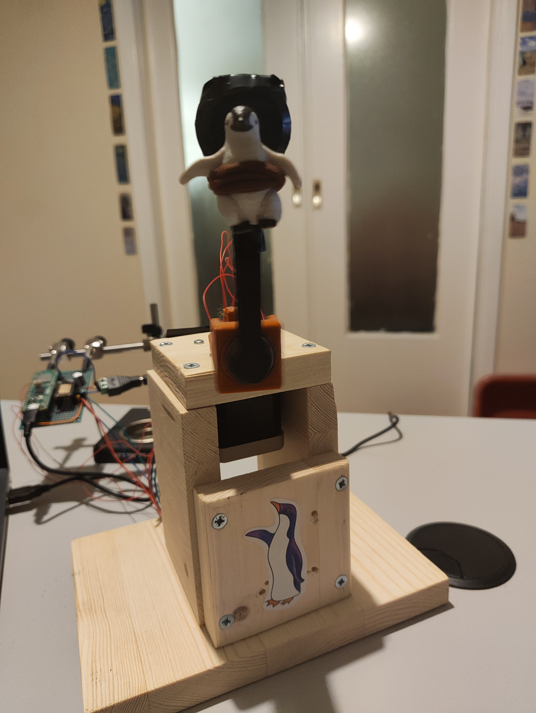

# penduin

This project was developed for a university course (Learning-based Control, NTUA).
It is a Furuta pendulum (rotary inverted pendulum) solved with RL.
The physical plant was built with wood, the arm and the pendulum were 3d-printed and the electronics used are shown in the list.md file.

## results
<gif or photos here>


## quick start 

#### simulation (python/)
```bash
# setup (Python 3.11)
conda env create -f environment.yml && conda activate penduin
# or: pip install -r requirements.txt

# watch the final agent in the MuJoCo viewer
python python/eval.py -f models/sac_QR101_675000_steps.zip -w

# train a new agent (reward mode, run name, steps etc. are set at the top of train.py)
python python/train.py
tensorboard --logdir runs

# pick the best checkpoint of a run
python python/best_model.py -n sac_QR101

# LQR balance baseline in simulation
python python/lqr.py -m exp -w
```

#### hardware (firmware/)
```bash
# export the agent's weights to firmware/stepper_motor/weights.h
# (the checkpoint is set inside weights.py)
python python/weights.py

# build (needs the Pico SDK, board: pico2_w)
cd firmware/stepper_motor
mkdir -p build && cd build
cmake .. && make main
```
Flash: hold BOOTSEL while plugging in the Pico, then copy `build/main.uf2` to the drive that appears. The Pico prints its logs over USB serial.

## folders
The project is divided in two main categories, the simulation for the pre-training of the model and the code for testing and running the motor and the encoder. Below, each folder is presented with a brief description.

#### python/ (lack of a better name)
The folder where the training and evaluation of the simulated model is, along with some scripts for other tasks like exporting the network weights, fitting the simulated model to the physical one for system identification and designing the LQR controller.

#### firmware/
The folder that hosts all the C and asm code that interacts with the plant. More specifically, stepper.c drives the motor with the help of move.pio/read.pio (asm programs that run on Pico's PIO), encoder.c reads the encoder, agent.c performs a forward pass on the trained agent's weights and main.c coordinates everything. Again, other files exist to help with other tasks like sys id.

#### STLs/
It holds the STLs files for the model.xml and the 3d-printing. Older versions are there too. The last versions are the ones used in model.xml.

#### models/ - checkpoints/
They host each trained model's info, sampled across the training process. The fully trained model isn't always the best, so a checkpoint can ascend to the models/ status.

#### runs/ - data/
runs/ holds the information for tensorboard to show the progress and data/ holds the csv logs used for system id.

#### images/
images and videos of build in action.

## steps
1. order the components
2. write the .xml model and build a simulation environment that mimics as much as possible the real setup
3. design a reward function, train a model and evaluate/watch it in simulation
4. write the C code that controls the motor and reads the encoder
5. build the robot and connect the components on a breadboard to test them
6. solder the circuit
7. balance the pendulum with LQR to verify that the modeled and physical version of the pendulum are close
8. export the weights from the trained agent in C arrays and write a C function that does a deterministic forward pass on the network


### us
Team members: 
Nelly Tsimplaki
Periklis Alexiou

#### references and related work
documentation:
https://stable-baselines3.readthedocs.io/en/master/modules/sac.html
https://mujoco.readthedocs.io/en/stable/XMLreference.html

references:
https://arxiv.org/abs/1801.01290
https://www.researchgate.net/publication/221345233_PILCO_A_Model-Based_and_Data-Efficient_Approach_to_Policy_Search

datasheets:
https://www.alldatasheet.com/html-pdf/1260879/PROMOCO/42BYGHW804/345/1/42BYGHW804.html # motor
https://github.com/bigtreetech/BIGTREETECH-TMC2209-V1.2/blob/master/manual/TMC2209-V1.2-manual.pdf # motor driver
https://pip-assets.raspberrypi.com/categories/1088-raspberry-pi-pico-2-w/documents/RP-008304-DS-3-pico-2-w-datasheet.pdf # microcontroller
https://files.seeedstudio.com/wiki/Grove-12-bit-Magnetic-Rotary-Position-Sensor-AS5600/res/Magnetic%20Rotary%20Position%20Sensor%20AS5600%20Datasheet.pdf # encoder

inspiring related work:
https://github.com/EmiliosBlacksea/furuta-pendulum-rl
https://courses.ece.cornell.edu/ece5990/ECE5725_Fall2019_Projects/Dec_13_Demo/Self-Balance%20Pendulum/bl569_sh974_Friday/index.html
https://github.com/ferrolho/rotary-inverted-pendulum

enlightening yt videos and articles:
https://medium.com/geekculture/raspberry-pico-programming-with-pio-state-machines-e4610e6b0f29
https://www.lazy-automation.com.au/tmc2209-stepper-driver-explained-silent-printing-and-what-it-actually-does
https://medium.com/@exsenily/soft-actor-critic-sac-for-continuous-control-an-introduction-and-possible-implications-for-5767e4cd620a 
https://medium.com/@dhananjaysaikumar_44502/mujoco-for-beginners-how-simulation-memory-actually-works-1e2a91c5fe86
https://towardsai.com/p/artificial-intelligence/quick-start-robotics-and-reinforcement-learning-with-mujoco
https://www.youtube.com/watch?v=7spK_BkMJys
https://www.youtube.com/watch?v=yvrpIYc9Ll8

##### code
The code was mostly written by us but there are scripts that we were too bored/tired to write and review at the time, so they are ai-generated. 
These are the following scripts, so mistakes might exist:
firmware/{encoder_test.c, motor_test.c, swing_log.c}
python/{best_model.py, excitation.py, log_serial.py, sysid.py, sysid_b.py}
